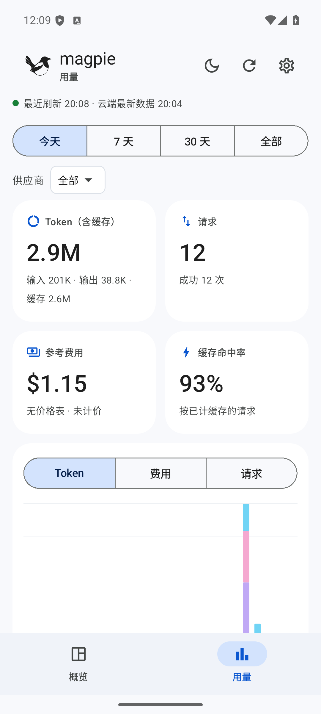
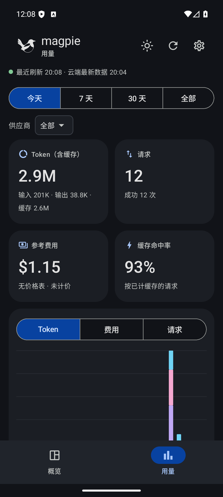

# Magpie Pocket

**把 Magpie 桌面端共享的 AI 用量与额度历史，放进口袋。**

Magpie Pocket 是一个非官方、独立维护的 Android 用量看板，配合 [yetone/magpie](https://github.com/yetone/magpie) 桌面端使用。它通过你配置的 WebDAV 下载共享文件，在手机上解密、归档并统计。

**本项目不是 Magpie 官方 Android 客户端。手机上的参考费用、额度读数及统计结果可能与桌面端不同，也不代表供应商账单。** 原因和具体计算公式见[数据来源与计算方式](docs/DATA_AND_CALCULATIONS.md)。

## 功能

- 额度概览：剩余/已用百分比、读数时间、过期标记、按供应商和账号展开。
- 用量看板：今天、7 天、30 天、全部；Token、请求、参考费用、缓存命中率。
- 按模型、供应商、模型·供应商、Agent、账号拆分；趋势图和 53 周热力图。
- WebDAV 增量下载；按连接隔离本机归档。
- Material 3 界面，浅色、深色和跟随系统；顶栏可快捷切换。
- 本机解密，远端只读；没有本项目运营的用量收集服务器。

## 界面

以下截图均为虚构演示数据。

| 浅色 | 深色 |
| --- | --- |
|  |  |

[额度概览](docs/images/overview-light.png) · [外观与连接设置](docs/images/settings.png)

## 使用条件与连接

需要 Android 8.0（API 26）及以上，以及已启用共享用量的 Magpie 桌面端。内置默认地址面向坚果云；其他兼容 WebDAV 的服务需要自行验证。

1. 在桌面端配置 WebDAV，并开启“共享用量”。只有配置备份成功，不代表请求用量已经上传。
2. 在手机设置填写服务器地址、账号、**WebDAV 应用密码**、完整用量目录及 **Magpie 同步口令**。
3. 应用密码用于访问 WebDAV；同步口令用于解密 Magpie 文件，二者用途不同。
4. 用量目录相对于服务器地址，例如服务器 `https://dav.jianguoyun.com/dav/` 对应目录 `/magpie/usage/`。桌面端配置了子目录时，也要包含该子目录。
5. 点“测试连接”验证，再点“保存并同步”。首次导入需要逐文件下载和派生密钥，可能较慢。

桌面数据不是实时推送：参考桌面版本约每 15 分钟上传一次；手机前台检查与后台调度是另一层间隔。后台受 Android 省电策略限制，无法保证准时刷新。

## 获取与构建

当前源码版本：**0.10.0**。本仓库初始发布以源码为主，不将本机 debug APK、签名文件或构建缓存提交到 Git。

使用 Android Studio 或 Gradle Wrapper 构建，详见[构建指南](docs/BUILDING.md)。GitHub Actions 成功后可下载 debug APK artifact（通常需要登录 GitHub）；debug 包只适合试用，发布签名及升级兼容性由后续发布流程管理。

```bash
./gradlew testDebugUnitTest assembleDebug
```

Windows 使用 `gradlew.bat testDebugUnitTest assembleDebug`。

## 文档

- [数据来源、统计公式、价格估算与桌面差异](docs/DATA_AND_CALCULATIONS.md)
- [隐私与凭据处理](docs/PRIVACY.md)
- [架构与同步协议](docs/ARCHITECTURE.md)
- [构建与测试](docs/BUILDING.md)
- [已知限制与排查](docs/LIMITATIONS.md)
- [贡献指南](CONTRIBUTING.md) · [安全问题](SECURITY.md)

## 与上游的关系及授权

协议与统计规则以 Magpie `6acf5ee5c38865eae2fe47e879905120b2ca272c`（2026-11-12）为参考，未来版本的文件格式、定价规则和字段可能变化。

喜鹊标识沿用上游原始 SVG，保留 MIT 授权；模型公开价格来自 [models.dev](https://models.dev)。本项目采用 [MIT](LICENSE) 授权，第三方来源见 [THIRD_PARTY_NOTICES.md](THIRD_PARTY_NOTICES.md)。名称与图标的使用不代表上游认可或官方关联。

