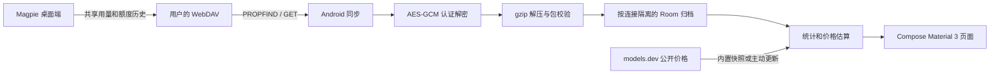

# 架构与同步协议

## 模块

- core/crypto：magpie-data envelope、PBKDF2-HMAC-SHA256 与 AES-256-GCM。
- core/pack：文件名、日期包和额度包解析，gzip 与大小限制。
- core/webdav：只读 WebDAV、XML 目录解析、鉴权、重定向和下载限制。
- data：DataStore、Keystore 封装凭据、Room 清单与记录、价格表。
- sync：连接快照、一次同步、前台轮询与 WorkManager 调度。
- domain：汇总、额度合并、热力图、公开价格估算。
- ui：概览、用量、整理、设置及主题。

## 文件处理

每轮读取目录元信息，优先 ETag，缺失时用修改时间/长度。无可靠版本时受控周期重读，当前为 6 小时；不能认为每次手动刷新都重下全部历史。

下载后依次校验 envelope、派生密钥、认证解密、解压、解析及文件名/包内设备日期一致性，完成后才替换该文件快照。文件级替换事务避免重复追加；失败不把未成功解析的版本视为已导入。

现有下载上限 64 MiB、解压上限 256 MiB，KDF 工作量也有限制。这些是资源边界，不代表低内存设备能承受接近上限的文件；当前仍有完整字节数组和 JSON 对象分配。

## 封装基线

支持 magpie-data / version 1 / pbkdf2-sha256。派生 32 字节密钥；AES-256-GCM 使用 12 字节 nonce 和 128 位认证 tag。AAD 包含 format、version、kdf、iterations 以及 salt 的小写十六进制表示。未知组合应报不支持，不自动猜测替代算法。

## 并发与归档

前台与后台同步经协调器互斥；连接采集和配置保存共用 gate，一次同步固定目录、客户端、凭据和归档。页面按当前连接和刷新序号接收结果。互斥表示串行执行，并不保证所有同时点击的刷新都会合并为一次。

归档用于保留已导入历史；远端文件轮换清理不自动清除本机全部历史。UI 的隐藏/排序属于显示偏好，不改变原始统计。
